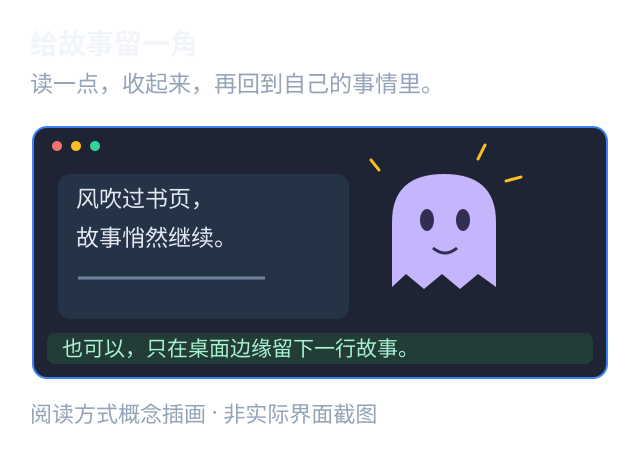

# GhostReader 幽灵阅读器

一个轻量的 Windows 本地 TXT / EPUB 阅读器。把正文放进透明桌面小窗，或者收成任务栏附近的一条文字；两种视图共享阅读进度，想看时展开，读完就收起来。

当前版本：**1.5.1** · C# / .NET 8 WinForms · MIT License



*概念示意图，非应用截图。*

## 下载与启动

在 [Releases](https://github.com/1056121380/GhostReader/releases) 下载 Windows x64 压缩包，解压后运行 `GhostReader.exe`。发布包自带运行时，无需安装 .NET SDK。首次使用，右键阅读区或托盘图标，选择“导入 TXT / EPUB”。

Windows 10/11 x64；不同任务栏、多屏和 DPI 组合请以实际表现为准。未签名的个人项目，Windows 可能提示未知发布者。

## 能做什么

- **两种阅读区域**：透明桌面小窗与任务栏附近的小条，可独立开启、拖动和缩放。
- **分别调外观**：背景与文字透明度独立，字体、字号和颜色可调；设置支持预览与取消。
- **连续自动滚动**：速度和方向可调；打开菜单、拖动窗口时暂停，手动翻阅后停止自动滚动。
- **本地书籍**：TXT 编码识别、EPUB 正文解析、章节搜索和按原文位置保存进度。
- **快捷恢复**：隐藏与恢复、鼠标穿透、快捷键冲突回退、托盘找回入口。

主程序没有联网、内容上传、自动更新、开机启动或文件关联注册逻辑。任务栏阅读条是独立浮层，不修改 Explorer，也不隐藏进程或保证屏幕共享时不可见。

## 常用快捷键

| 默认组合 | 动作 |
| --- | --- |
| Ctrl+Alt+M | 隐藏 / 恢复阅读区域 |
| Ctrl+Alt+Down / Up | 翻页；小条模式逐行翻阅 |
| Ctrl+Alt+S | 打开设置 |
| Ctrl+Alt+T | 切换鼠标穿透 |
| Ctrl+Alt+A | 开始 / 暂停自动滚动 |
| Ctrl+Alt+Shift+X | 退出 |

快捷键可自定义。被占用时程序会尝试备选组合，并在设置中显示实际生效的按键。隐藏托盘前请确认找回方式；完全透明或启用鼠标穿透后，可通过设置快捷键恢复。

## 构建

在 Windows 安装 .NET SDK 8 或更高版本：

```powershell
dotnet build GhostReader.csproj -c Release
powershell -NoProfile -File scripts/build.ps1
```

独立运行版输出到 `release/win-x64/`。首次还原依赖和发布运行时需要联网。

## 验证

```powershell
powershell -NoProfile -File scripts/verify.ps1
```

先执行构建脚本。验证会编译并运行 `Tests/` 中的回归程序，再对发布版执行自检；使用独立配置目录。测试包含原生 Windows 窗口、快捷键和任务栏交互，建议在可用的 Windows 桌面会话运行，可能短暂显示测试窗口。报告写入 `artifacts/verification/`。

GitHub Actions 负责在 Windows 上编译源码、编译测试并生成运行包；不将无人值守构建等同于完整交互验收。

## 配置与边界

- 默认配置在 `%APPDATA%/GhostReader/`，包括设置、阅读进度和异常日志；仓库不包含个人配置和阅读历史。
- `GHOSTREADER_PROFILE` 可指定独立配置目录。重置前先退出程序并备份配置。
- `GhostReader.exe --settings` 打开设置，`--hidden` 以隐藏状态启动，`--selftest` 执行自检。
- TXT 支持常见 Unicode 与 GB18030/GBK 编码；无 BOM 的编码猜测不是绝对可靠。EPUB 按 spine 顺序导入正文，不执行内嵌脚本；不支持 DRM 解锁与完整复杂排版。
- 进度按原文段落和字符偏移保存；书籍内容或路径大幅变化时，旧进度可能不再适用。
- 自动避开任务栏图标属于基于屏幕像素的启发式定位，第三方任务栏、独占全屏、多屏 DPI 等环境下可关闭自动避让、手动调整位置。

## 项目结构

`Core/` 为窗口、排版、书籍解析和状态；`Ui/` 为设置与章节界面；`Tests/` 为回归验证；`scripts/` 为构建和验证入口。`_testdata/` 只有简短编码测试文本，不含用户书库。

欢迎通过 Issues 报告问题。请注明 Windows 版本、缩放比例、是否使用第三方任务栏及复现步骤，避免上传私人书籍、配置或日志中的敏感信息。

## 许可证

项目源码采用 [MIT](LICENSE)。NuGet 依赖和发布时附带的 .NET 运行时保留其各自的许可证，见 [第三方说明](THIRD_PARTY_NOTICES.md)。
